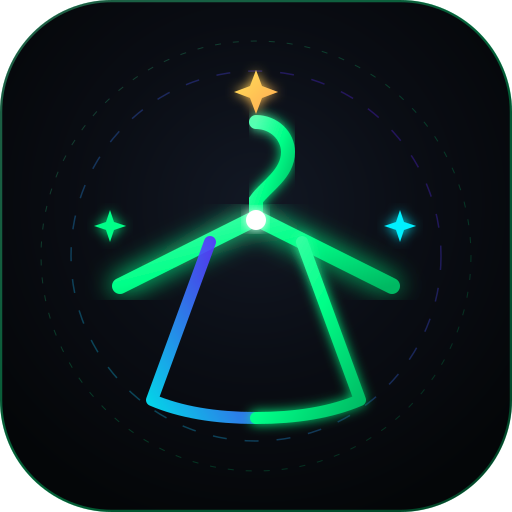
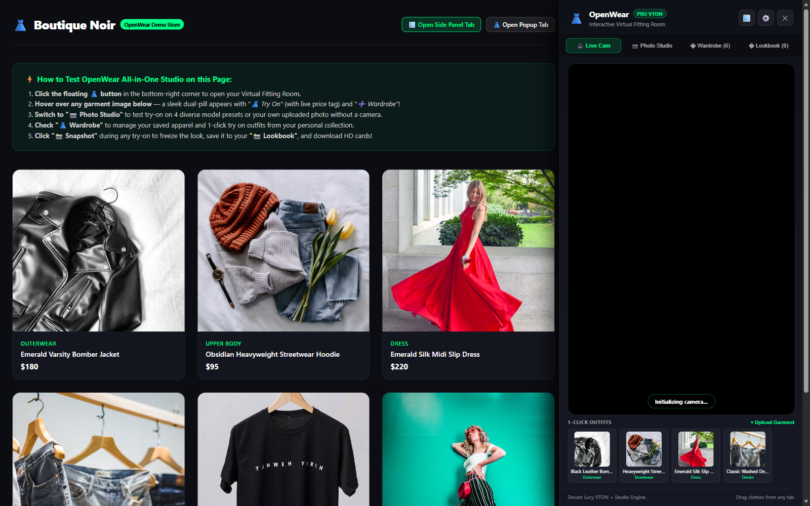
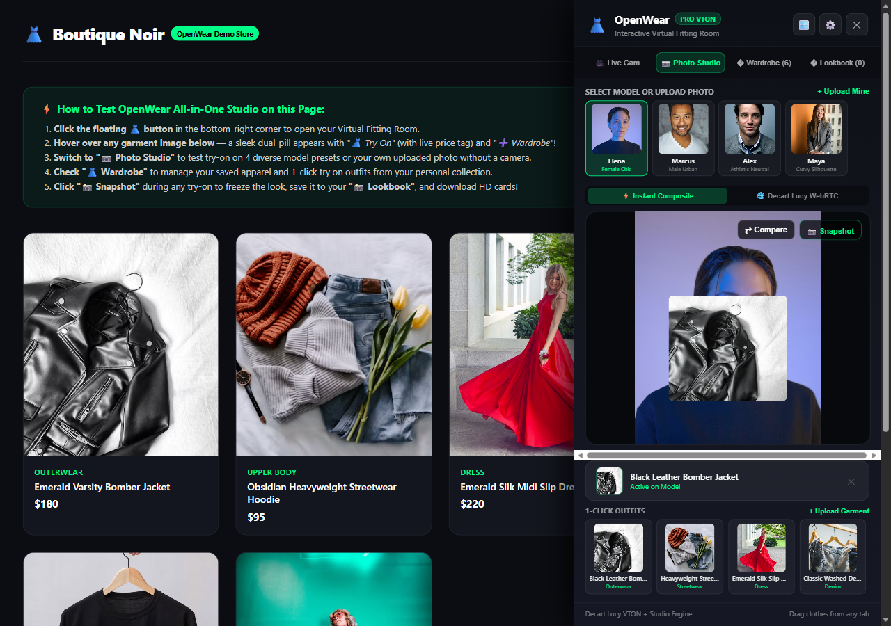
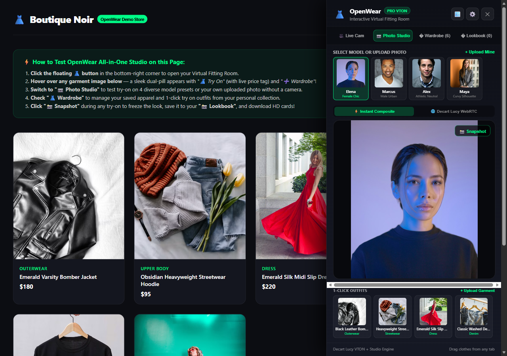
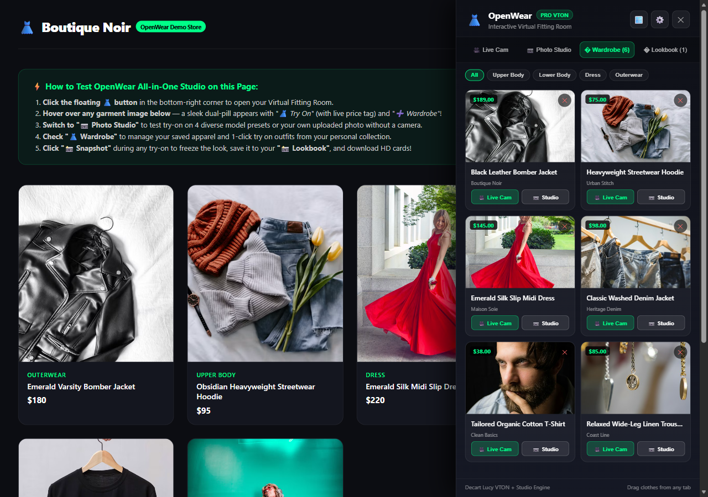

<div align="center">

  

  # 👗 OpenWear

  ### Next-Generation AI Virtual Fitting Room & Smart Mirror Kiosk

  <p align="center">
    Try clothes on live in realtime across any shopping website — or turn any big-screen TV into an in-store AI smart fitting mirror.
  </p>

  <p align="center">
    <a href="#-key-features"></a>
    <a href="#-tech-stack"></a>
    <a href="#-tech-stack"></a>
    <a href="#-tech-stack"></a>
    <a href="#-license"></a>
  </p>

</div>

---

## 📖 Overview

**OpenWear** is an open-source AI virtual fitting room and retail smart mirror platform. Built with **Plasmo (Manifest V3)**, **React 18**, **TypeScript**, and **Decart Lucy VTON WebRTC streaming**, OpenWear bridges the gap between digital e-commerce and physical retail apparel shopping.

OpenWear offers **two complementary experiences**:

1. **🛍️ Browser Shopping Companion**: Hover over any clothing item on Zara, Amazon, Myntra, ASOS, or H&M to instantly try it on. Features a **true 70:30 desktop reflow layout** where the store stays 70% visible while the fitting room occupies 30% on the right.
2. **🖥️ In-Store Smart Mirror Kiosk**: Plug your laptop into any TV (e.g., 32" OnePlus TV) and mount your mobile phone camera (via Iriun Webcam). Run OpenWear in full-screen TV mirror mode with dual-screen laptop control, 3-2-1 photobooth countdown, and QR code sharing for shoppers.

---

## 🌟 Key Features

### 1. Dual-Experience Virtual Fitting Engine
- **🎥 Live Cam Mode**: Real-time peer-to-peer WebRTC streaming powered by Decart's `lucy-vton-latest` model. Transposes garments onto your live webcam feed with sub-second latency and zero on-screen watermarks.
- **📷 Offline Photo Studio**: Try garments on without a camera using 4 bundled photorealistic model presets (Elena, Marcus, Alex, Maya) or by uploading your own photo.
- **⇄ Before/After Comparison Slider**: Drag an interactive slider handle across the try-on result to compare the original outfit against the virtual garment.

### 2. Retail Smart Mirror Kiosk & Dual-Screen Sync
- **100% Edge-to-Edge Mirror View**: Clean, borderless camera feed designed for 32" to 55" vertical or widescreen TV displays.
- **Dual-Screen Live Control**: The store associate browses apparel on the laptop; clicking **"🖥️ Cast TV"** instantly pushes that outfit onto the TV mirror in real time.
- **📸 3-2-1 Photobooth & Flash**: Triggers an animated on-screen countdown and screen flash to capture snapshots of customers wearing their selected outfits.
- **📱 QR Code "Take Home"**: Generates a scannable QR code on the TV so customers can download their high-resolution look to their mobile phones to share on Instagram or WhatsApp.
- **TV Remote & Keyboard Shortcuts**: Fully navigable using arrow keys, spacebar, and TV remotes.

### 3. Personal Wardrobe & Lookbook Studio
- **👗 My Wardrobe**: Automatically scrapes product titles, prices, store domains, and apparel categories (`Tops`, `Bottoms`, `Dresses`, `Outerwear`) with persistent local storage.
- **📸 Lookbook Studio**: Exports 1080×1350 fashion catalog cards stamped with garment details, store metadata, and dates for social sharing.
- **🛍️ Smart Dual Scraper**: Injects unobtrusive floating hover pills (**"👗 Try On"**, **"➕ Wardrobe"**, **"🖥️ Cast TV"**) on product images across any website.

---

## 📸 Interface Showcase

| 70:30 Desktop Split View | Live AI Try-On & Before/After Slider |
|:---:|:---:|
|  |  |
| *Shopping store reflows into 70% width without overlay clipping* | *Realtime virtual garment drape with comparison handle* |

| Offline Photo Studio (4 Preset Models) | My Wardrobe Collection & Scraper |
|:---:|:---:|
|  |  |
| *Elena, Marcus, Alex & Maya with custom photo upload* | *Saved garments with live price extraction and 1-click try-on* |

---

## 🏗️ System Architecture

```mermaid
flowchart TD
    subgraph Input_Layer ["Input & Media Layer"]
        CAM["🎥 Webcam / Phone Camera\n(Iriun / DroidCam 1080p)"]
        WEB["🛍️ Shopping Website\n(Zara, Amazon, Myntra)"]
        STORE["👗 Store Catalog / Uploads\n(Local Rack Photos)"]
    end

    subgraph Core_Engine ["OpenWear Core Engine"]
        EXT["OpenWear Extension\n(Plasmo MV3 + React 18)"]
        PROXY["Background CORS Proxy\n(Blob & Base64 Encoder)"]
        SYNC["Kiosk Synchronizer\n(BroadcastChannel + Runtime API)"]
        PHOTO["Photo Studio Engine\n(Canvas Inpainting & Presets)"]
        VTON["Decart Lucy Client\n(Ephemeral Token & WebRTC)"]
    end

    subgraph Output_Layer ["Display & Deployment Layer"]
        DESKTOP["💻 Laptop Shopping Reflow\n(70% Store : 30% OpenWear)"]
        TV["🖥️ 32-55\" OnePlus TV Kiosk\n(tabs/kiosk.html Smart Mirror)"]
        LOOK["📸 Lookbook Card Export\n(1080x1350 HD Social Cards)"]
        QR["📱 Customer Smartphone\n(QR Code Photo Download)"]
    end

    CAM --> EXT
    WEB --> PROXY
    STORE --> PROXY
    PROXY --> VTON
    PROXY --> PHOTO
    EXT --> SYNC
    VTON --> DESKTOP
    SYNC --> TV
    PHOTO --> DESKTOP
    TV --> LOOK
    LOOK --> QR
```

---

## 📺 In-Store Kiosk Setup Guide (TV + Phone Camera)

Turn any physical clothing boutique into a futuristic smart mirror using hardware you already have:

```
[ 32" to 55" OnePlus TV ]   <-- Full-screen Smart Mirror Display (tabs/kiosk.html)
           ↑ (HDMI / Wireless Cast)
      [ Laptop ]             <-- Store Associate Console (browsing store items)
           ↑ (USB / Wi-Fi)
 [ Mobile Phone Camera ]     <-- Mounted below/above TV running Iriun Webcam
```

### 1. Setup Mobile Phone as HD Webcam (2 Minutes)
1. Install **Iriun Webcam** on your mobile phone ([Google Play](https://play.google.com/store/apps/details?id=com.jacksoftw.webcam) / App Store).
2. Install **Iriun Webcam for Windows** on your laptop ([iriun.com](https://iriun.com)).
3. Connect your phone via USB charging cable (for zero latency) or same Wi-Fi.
4. Mount your phone at chest height (4.5–5 ft) pointing towards where customers will stand (5–6 ft away).

### 2. Connect Laptop to TV
- **Option A (HDMI Cable - Recommended)**: Connect HDMI from laptop to TV HDMI port. Press `Win + P` and choose **"Duplicate"** or **"Second screen only"**.
- **Option B (Wireless Cast)**: Ensure both devices are on the same Wi-Fi. Press `Win + K` on your laptop and choose your **OnePlus TV**.

### 3. Launch Store Kiosk
1. Click the **👗 OpenWear icon** in Chrome and select **`🖥️ Launch In-Store Kiosk (TV Mirror Mode)`**.
2. Move the window to the TV screen and press **`F`** (or `F11`) for borderless fullscreen.
3. Select **"Iriun Webcam"** from the camera switcher.
4. From your laptop, click **`🖥️ Cast TV`** on any garment to dress the person standing in front of the TV!

---

## 🎮 TV Remote & Keyboard Shortcuts

| Key | Action | Context |
| :--- | :--- | :--- |
| **`Arrow Left` / `Arrow Right`** | Navigate through in-store garments | TV Mirror Kiosk |
| **`Enter`** | Try on selected garment live | TV Mirror Kiosk |
| **`Space`** or **`C`** | Trigger 3-2-1 Photobooth Countdown & Flash | TV Mirror Kiosk |
| **`F`** | Toggle Fullscreen on TV | TV Mirror Kiosk |
| **`H`** | Hide / Show all buttons (100% clean mirror reflection) | TV Mirror Kiosk |
| **`Esc`** | Close QR code or settings modal | TV Mirror Kiosk |

---

## 🛠️ Tech Stack

- **Extension Framework**: [Plasmo](https://docs.plasmo.com/) (Manifest V3)
- **UI & Components**: React 18, TypeScript, Tailwind CSS
- **Realtime Generative AI**: [@decartai/sdk](https://docs.platform.decart.ai/) (Decart Lucy VTON WebRTC)
- **Canvas Processing**: Native HTML5 OffscreenCanvas, Inpainting Composite Engine
- **Inter-Window Sync**: HTML5 `BroadcastChannel` + Chrome Extension Runtime Messaging
- **Package Manager**: pnpm

---

## 🚀 Getting Started

### Prerequisites
- [Node.js](https://nodejs.org/) (v18 or higher)
- [pnpm](https://pnpm.io/) (`npm i -g pnpm`)
- [Decart Platform API Key](https://platform.decart.ai/)

### Installation & Build

```bash
# 1. Clone the repository
git clone https://github.com/ajinkyachalke008/virtual-try-on-extension.git
cd virtual-try-on-extension

# 2. Install dependencies
pnpm install

# 3. Build the production extension
pnpm build
```

### Load Extension into Chrome / Edge

1. Open your browser and navigate to `chrome://extensions/` (or `edge://extensions/`).
2. Toggle **Developer mode** to **ON** in the top-right corner.
3. Click **Load unpacked** in the top-left corner.
4. Select the build directory:
   ```
   virtual-try-on-extension/build/chrome-mv3-prod
   ```
5. Pin **OpenWear 👗** to your browser toolbar!

---

## 🧪 Testing

```bash
# Run TypeScript typecheck
pnpm exec tsc --noEmit

# Test Decart Lucy WebRTC Signaling & Token Generation
node test-decart-ws.js
```

---

## 🗺️ Roadmap

- [x] Decart Lucy VTON WebRTC real-time video streaming
- [x] True 70:30 desktop reflow split screen layout
- [x] Offline Photo Studio with 4 diverse models and Before/After slider
- [x] Watermark-free clean video viewport
- [x] In-Store Smart Mirror Kiosk fullscreen mode (`tabs/kiosk.html`)
- [x] Dual-screen live sync (Laptop Associate Console ↔ TV Mirror)
- [x] 3-2-1 Photobooth countdown snapshot & QR code download
- [ ] In-store barcode scanner integration (USB / Bluetooth barcode guns)
- [ ] Multi-store cloud catalog synchronization (Shopify / WooCommerce sync)

---

## 📄 License

This project is licensed under the [MIT License](LICENSE).
